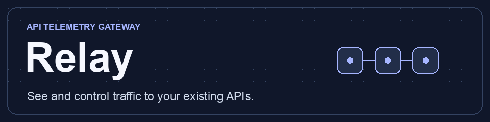
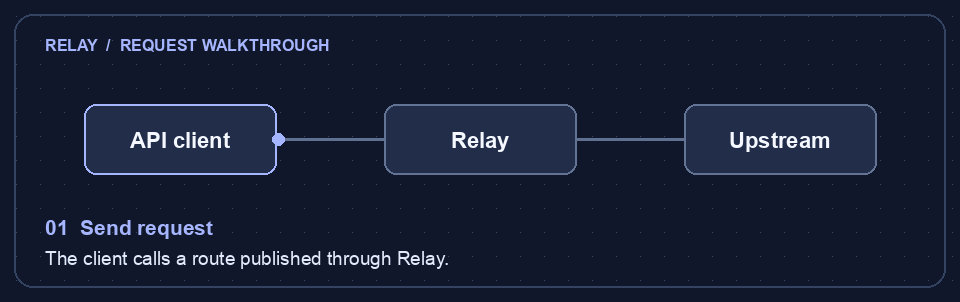

# Relay



A self-hosted gateway for existing HTTP APIs. The web catalog supports manual upstream registration and OpenAPI imports with a route preview and explicit publishing.

- Go 1.25+ and the standard library HTTP reverse proxy.
- SQLite via the pure-Go modernc.org/sqlite driver.
- Server-rendered HTML and CSS embedded in the Go binary.

[Quick start](#run-locally) · [OpenAPI import](#import-an-openapi-api) · [Team access](#teams-keys-and-traffic-policies) · [Operations](#operate-a-deployment)

## Explore the features

<details open>
<summary><strong>Follow a request through Relay</strong></summary>



A client calls Relay’s published endpoint. Relay checks the gateway key and applicable traffic policies, forwards allowed requests, and batches status and timing data for the dashboard.

</details>

<details>
<summary><strong>Preview API changes before publishing</strong></summary>

[Import an OpenAPI document](#import-an-openapi-api), review the routes, and test upstream reachability before publishing. Relay keeps the active routes in memory, and you can reactivate a previous published revision from the portal.

</details>

<details>
<summary><strong>Give each application its own key</strong></summary>

[Grant teams access to selected APIs](#teams-keys-and-traffic-policies). Team admins can issue keys to their applications and rotate them with an overlap window so clients can switch without downtime. Revocation applies to subsequent requests immediately.

</details>

<details>
<summary><strong>Measure traffic and enforce limits</strong></summary>

See request counts, 5xx errors, gateway denials, and p50, p95, and p99 latency in the [dashboard](#explore-requests). Find individual requests by ID and export matching events as CSV. Use [traffic policies](#teams-keys-and-traffic-policies) to observe or enforce quotas and IP rules.

</details>

<details>
<summary><strong>Make bulk changes and track who made them</strong></summary>

[Bulk jobs](#bulk-jobs) preview OpenAPI imports and traffic rules, report failures by item, and support retry. The [audit log](#audit-log) records the actor and target for committed changes.

</details>

## Run locally

Set `GATEWAY_ADMIN_PASSWORD` to a password of at least 16 characters, then run:

```sh
go run ./cmd/gateway
```

Open the admin portal at `http://127.0.0.1:8081/` and sign in as `admin`. Add a slug such as `billing` and an upstream URL. Send a request to `http://127.0.0.1:8080/gateway/billing/` to reach that upstream. For an upstream URL ending in `/api`, a request to `/gateway/billing/invoices` reaches `/api/invoices`.

Use `-listen`, `-admin-listen`, and `-db` to change the addresses and database path. Keep the administration listener private and use TLS if exposing it beyond loopback. The gateway forwards client authorization to upstreams. The Teams & Keys screen can require a gateway credential for a published API.

## Import an OpenAPI API

In the admin portal, select **Import OpenAPI**, enter the upstream URL, and choose an OpenAPI 3.0 or 3.1 JSON or YAML file. The importer accepts one document of up to 1 MiB and up to 500 operations. It supports literal path segments and full-segment parameters such as `/invoices/{id}`. Resolve path references before uploading.

**Preview routes** saves a draft to SQLite. Review the methods and gateway paths, then select **Publish API**. The gateway serves imported routes only after publication and accepts only matching methods and paths. Manual APIs continue to forward any method and path under their registered prefix.

Use **Test upstream connection** from the draft preview to make a five-second HEAD probe against the configured upstream URL. An HTTP response confirms reachability even when the upstream returns an error status. To prepare a replacement revision, import a file with the same slug and select **Update an existing imported API**. The previous revision serves traffic until the new draft is published. Open **History** on a published API to reactivate an earlier published revision.

The gateway loads published routes into memory at startup. Adding a manual API or publishing an import updates the live routing table after SQLite saves the change. Proxy requests use that table directly. Manage configuration through the portal on the same gateway instance.

## Explore requests

Open **Requests** in the admin portal. Filter the latest 100 matching events by API slug, HTTP status, or the `X-Request-ID` returned by the gateway and sent upstream. Events include method, imported route template, gateway outcome, status, and elapsed time. Manual APIs are grouped under a single label. Telemetry excludes raw paths, query values, headers, and bodies.

The gateway queues events in memory and writes them to a separate SQLite file at `<db path>.telemetry`, in batches of up to 128 or about every 500 milliseconds. The explorer shows the count of events dropped when the queue is full or a batch fails after retry. The database retains the most recent 100,000 events. Graceful shutdown drains the queue.

**Dashboard** shows per-API request counts, 5xx responses, gateway denials, and p50, p95, and p99 latency. Select the last hour, 24 hours, or seven days of retained events. **Download CSV** exports the latest 100 events matching the Request Explorer filters.

## Teams, keys, and traffic policies

In **Teams & Keys**, create a team, issue a key for a named application and published API, and copy the one-time secret. Send it as `X-Gateway-Key`. Enable **Require gateway key** for the API when clients are ready. The gateway strips that credential before forwarding. Keys are stored as hashes, and rotation can overlap for up to seven days. Revocation applies to subsequent requests immediately.

From **Teams & Keys**, open **Team members and API grants** as the workspace administrator. Create a portal account, share its one-time password securely, and assign a role to a team. Grant that team access to each published API it needs.

| Role | Access |
| --- | --- |
| Viewer | Catalog, dashboard, request explorer, and quick CSV for granted APIs |
| Operator | Viewer access plus revision drafts and history for granted APIs |
| Team admin | Operator access plus key issuance, rotation, and revocation for their teams and granted APIs |
| Workspace admin | Full portal, including publication, policy changes, bulk jobs, and audit |

Telemetry access is scoped by granted API slug and includes all traffic recorded for that API. Revoking a grant removes portal access and disables that team's keys for the API. Restoring the grant restores access to still-active keys. Revoke individual keys to permanently retire them.

In **Traffic Policies**, configure CIDR blocks and API, route, team, application, or anonymous IP quotas. Set a sustained rate per minute, a burst allowance, and observe or enforce mode. Application quotas apply to both keys during rotation. Enforced limits return `429` with `Retry-After`. Enforced IP blocks return `403`. Policy IDs appear in request telemetry. IP rules use the directly connected peer address unless trusted proxy CIDRs are configured. Quota counters are in memory for one instance and reset on restart.

Team, key, and policy settings live in `<db path>.access` and are loaded into memory for request evaluation.

## Audit log

**Audit Log** shows the latest 100 committed catalog and access changes, including publishing, reactivating revisions, issuing or revoking keys, and changing policies. Each entry is saved in the same transaction as its configuration change. Entries contain the actor and target identifiers. Gateway key secrets are excluded.

## Bulk jobs

Use **Bulk Jobs** to preview up to 20 OpenAPI documents or traffic rules in one job. The import preview shows each route before you run the job. OpenAPI jobs create drafts, and each draft can be reviewed and published separately. The job details show successes and failures, offer an error report, and let you retry failed processing items. Correct invalid preview items and submit them in a new batch.

Choose **Queue full export** in Requests to export matching telemetry retained when the worker reads it, up to the telemetry row boundary captured at submission. The export reads bounded batches and is available for 24 hours. The job database and export directory are adjacent to the configured catalog path as `<db path>.jobs` and `<db path>.jobs.files`.

## Operate a deployment

Run one gateway instance per database set. Store database files on a private, writable local volume and restrict access to the service account. Keep the admin listener on loopback or a private network. Set both `-tls-cert` and `-tls-key` to use HTTPS on both listeners. The certificate must cover the hostnames clients use. Restart the process after replacing the files. The gateway listener exposes `GET /healthz`.

Behind a proxy, set `-trusted-proxies` to the comma-separated CIDRs of proxies you operate. Restrict direct access to the gateway listener when relying on an edge proxy for authentication or other policies. Configure trusted proxies to append their immediate peer to `X-Forwarded-For`. The gateway walks the chain from the nearest hop to the first untrusted address, then uses that address for IP policies and forwards it upstream. It ignores forwarding headers from untrusted peers and rejects trusted chains with no usable client address.

### Backup and restore

1. Stop the gateway gracefully so it drains telemetry and stops the job worker.
2. Back up the catalog database and its `.telemetry`, `.access`, and `.jobs` companion databases together. Include the `.jobs.files` directory to preserve pending downloads. If SQLite sidecar files exist, retain them with the corresponding database files.
3. With the destination gateway stopped, restore the set under a common base path. Start the gateway with `-db` set to that path and configure its admin password, listeners, and TLS.
4. Check the catalog and dashboard, send a request with an active key, and verify that an unexpired export downloads.

### Verify locally

The smoke suite needs Python 3, OpenSSL, and permission to open local loopback listeners.

```sh
go test -race ./...
go vet ./...
go build -o gateway ./cmd/gateway
python3 tests/smoke.py ./gateway
```

The smoke suite covers live publication and rollback, team isolation and key revocation, IP policies, batch jobs and restart replay, HTTPS, and backup restoration. It sends 480 requests at concurrency 12 and checks that graceful shutdown persisted all 480 telemetry events.

## License

[MIT License](LICENSE) · Copyright © 2026 Umesh
